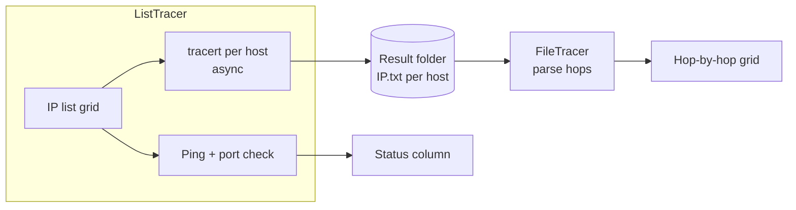

<div align="center">

# 🛰️ NetworkTracer

**Bulk traceroute, ping and port checks for a whole list of hosts — then replay the routes hop by hop.**

[](https://github.com/mr-aybee/network-tracer/actions/workflows/ci.yml)


[](LICENSE)

</div>

---

## Overview

NetworkTracer is a Windows Forms diagnostics tool for network engineers. Paste a list of IPs, run traceroutes against all of them concurrently, check reachability of a specific port, and save each route to its own log. The companion **FileTracer** view parses those logs back into a hop-by-hop grid for comparison.

## Features

- 🌐 **Bulk traceroute** with per-host max-hops and timeout
- 📶 **Ping status** for every destination
- 🔌 **Port check** across the whole list
- 🗃️ **Per-host logs** in a timestamped `Result [YYYY MM DD HH-mm-ss]` folder
- 🧭 **FileTracer** — parse saved logs into a hop table
- 📋 Editable grid with copy/paste support

## How it works



## Tech stack

| Layer | Technology |
| --- | --- |
| UI | C# · Windows Forms · .NET Framework 4.8 |
| Probing | `tracert` via hidden process, `System.Net.NetworkInformation.Ping`, TCP connect |
| Output | Plain-text route logs per host |

## Getting started

### Prerequisites

- Windows with .NET Framework 4.8
- Visual Studio 2019+ or MSBuild

### Build

```shell
git clone https://github.com/mr-aybee/network-tracer.git
cd network-tracer
msbuild NetworkTracer.sln /p:Configuration=Release
```

## Usage

**Trace a list of hosts**

1. Launch `NetworkTracer.exe` (opens **ListTracer**).
2. Enter IPs in the grid; optionally set **MaxHops** and **TimeOut** per row.
3. Click **Start Tracer**. Progress shows in the title bar; **Status** shows the ping result.
4. Routes are saved to `Result [timestamp]/<ip>.txt`.

**Check a port**

Enter a port next to **Port Start** and click it — **Status** shows ping plus port open/closed.

**Analyse saved routes**

Click **File Tracer**, point it at the result folder, add the same IPs and click **Start** to see each hop.

## Project structure

```text
network-tracer/
└── NetworkTracer/
    ├── ListTracer.cs      # Main window: bulk trace, ping, port check
    ├── FileTracer.cs      # Parses saved route logs into hops
    ├── Tracerter.cs       # Async tracert wrapper
    ├── PingTest.cs        # Ping helpers
    ├── CommandPrompt.cs   # Hidden process execution
    └── ScalarFuntions.cs  # Shared utilities
```

## Development

- Open `NetworkTracer.sln` in Visual Studio and build.
- CI builds with MSBuild on Windows for every push and pull request.

## Contributing

Contributions are welcome. Read [CONTRIBUTING.md](CONTRIBUTING.md) for the branch, build and pull-request workflow. Please report security issues privately through [GitHub security advisories](https://github.com/mr-aybee/network-tracer/security/advisories/new), not public issues.

## Code of Conduct

This project follows the [Contributor Covenant](CODE_OF_CONDUCT.md). By participating you agree to uphold it.

## License

Released under the [MIT License](LICENSE). © 2026 Abdullah Shahid.
